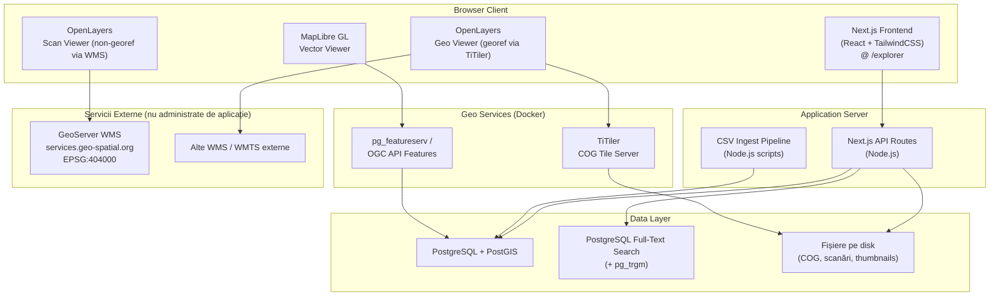
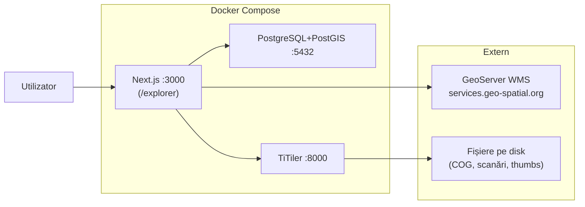

# A. Propunere de Arhitectură

> **Scop:** Aplicație de explorare a colecțiilor de date geo-spatial.org (eHarta + colecții mai recente).
> Aplicația rulează la `/explorer` indiferent de domeniu.

## A.1. Diagrama generală

> **Notă:** Aplicația **nu se ocupă de pregătirea datelor** (conversie COG, generare thumbnails, etc.). Echipa de administrare furnizează prin CSV-uri endpoint-urile și locațiile pe disk ale resurselor.

## A.2. Trei variante de arhitectură

### Varianta 1 — MVP

| Componentă | Alegere | Motivare |
|---|---|---|
| **Frontend** | Next.js 14+ (App Router) | SSR + SSG, routing, API routes integrate |
| **Styling** | TailwindCSS + shadcn/ui | Rapid, consistent, accesibil |
| **Bază de date** | PostgreSQL 16 + PostGIS 3.4 | Suport spatial nativ, full-text search integrat |
| **Căutare** | `pg_trgm` + `tsvector` | Fără infrastructură suplimentară |
| **Geo viewer (georef)** | OpenLayers 9+ | Cel mai matur viewer web GIS; afișare tile-uri TiTiler |
| **Scan viewer (non-georef)** | OpenLayers 9+ + WMS GeoServer | Vizualizare scanări via WMS cu EPSG:404000 |
| **Vector viewer** | MapLibre GL JS | Performant, styling flexibil |
| **Tile serving (georef)** | TiTiler (Docker) | Servire dinamică tile-uri din COG |
| **WMS scanări (non-georef)** | GeoServer extern | `https://services.geo-spatial.org/geoserver`, EPSG:404000 |
| **Vector serving** | GeoJSON static + pg_featureserv | Simplu |
| **Stocare fișiere** | Disk local (locații din CSV) | Fără MinIO/S3; TiTiler citește de pe disk |
| **Deploy** | Docker Compose | O singură mașină |

**Cost estimat:** O singură mașină 2-4 GB RAM, 100-500 GB storage.

### Varianta 2 — Intermediară

Adaugă peste MVP:

| Componentă | Upgrade |
|---|---|
| **Căutare** | Meilisearch (faceted search, typo tolerance) |
| **Vector serving** | pg_featureserv + Martin (MVT tiles) |
| **CI/CD** | GitHub Actions → Docker registry |
| **Monitoring** | Prometheus + Grafana |
| **Admin UI** | Dashboard intern ingestie CSV + validare |

### Varianta 3 — Producție / Scalabilă

Adaugă peste Intermediară:

| Componentă | Upgrade |
|---|---|
| **Căutare** | OpenSearch (cluster) |
| **CDN** | CloudFront / Cloudflare CDN |
| **Orchestrare** | Kubernetes |
| **Cache** | Redis pentru API + tile cache |
| **Auth** | NextAuth.js + role-based access |
| **OGC API** | pygeoapi ca gateway complet |
| **Backup** | Snapshot PG + disk versioning |

## A.3. Deployment MVP

