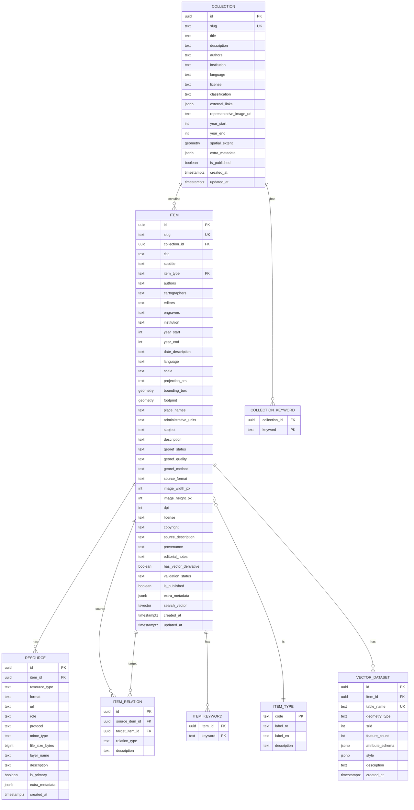

# B. Model de Date

> **Scop:** Model de date pentru colecțiile geo-spatial.org (eHarta + colecții mai recente).
> Datele sînt importate prin CSV-uri furnizate de echipa de administrare.

## B.1. Diagrama entitate-relație



## B.2. Schema SQL

```sql
-- Extensions
CREATE EXTENSION IF NOT EXISTS "uuid-ossp";
CREATE EXTENSION IF NOT EXISTS "postgis";
CREATE EXTENSION IF NOT EXISTS "pg_trgm";

-- ============================================================
-- COLLECTIONS
-- ============================================================
CREATE TABLE collections (
    id              UUID PRIMARY KEY DEFAULT uuid_generate_v4(),
    slug            TEXT NOT NULL UNIQUE,
    title           TEXT NOT NULL,
    description     TEXT,
    authors         TEXT,
    institution     TEXT,
    language        TEXT,
    license         TEXT,
    classification  TEXT,                         -- tip colecție: atlas, serie, fond etc.
    external_links  JSONB DEFAULT '[]'::jsonb,    -- [{label, url}]
    representative_image_url TEXT,
    year_start      INTEGER,
    year_end        INTEGER,
    spatial_extent  GEOMETRY(Polygon, 4326),
    extra_metadata  JSONB DEFAULT '{}'::jsonb,
    is_published    BOOLEAN DEFAULT FALSE,
    created_at      TIMESTAMPTZ DEFAULT now(),
    updated_at      TIMESTAMPTZ DEFAULT now()
);

CREATE INDEX idx_collections_slug ON collections(slug);
CREATE INDEX idx_collections_spatial ON collections USING GIST(spatial_extent);

-- ============================================================
-- ITEM TYPES (lookup)
-- ============================================================
CREATE TABLE item_types (
    code        TEXT PRIMARY KEY,
    label_ro    TEXT NOT NULL,
    label_en    TEXT NOT NULL,
    description TEXT
);

INSERT INTO item_types (code, label_ro, label_en) VALUES
    ('map',           'Hartă',              'Map'),
    ('plate',         'Planșă',             'Plate'),
    ('atlas_page',    'Pagină de atlas',    'Atlas page'),
    ('chart',         'Grafic',             'Chart'),
    ('text_page',     'Pagină text',        'Text page'),
    ('table',         'Tabel',              'Table'),
    ('legend',        'Legendă',            'Legend'),
    ('technical',     'Planșă tehnică',     'Technical plate'),
    ('composite',     'Compozit',           'Composite'),
    ('other',         'Altul',              'Other');

-- ============================================================
-- ITEMS
-- ============================================================
CREATE TABLE items (
    id                    UUID PRIMARY KEY DEFAULT uuid_generate_v4(),
    slug                  TEXT NOT NULL UNIQUE,
    collection_id         UUID NOT NULL REFERENCES collections(id) ON DELETE CASCADE,
    title                 TEXT NOT NULL,
    subtitle              TEXT,
    item_type             TEXT NOT NULL REFERENCES item_types(code),

    -- Creators
    authors               TEXT,
    cartographers         TEXT,
    editors               TEXT,
    engravers             TEXT,
    institution           TEXT,

    -- Temporal
    year_start            INTEGER,
    year_end              INTEGER,
    date_description      TEXT,       -- "circa 1870", "ante 1900"

    -- Descriptive
    language              TEXT,
    scale                 TEXT,       -- "1:50000", "variabilă"
    projection_crs        TEXT,       -- "EPSG:3844", "Bonne"
    description           TEXT,
    subject               TEXT,
    source_description    TEXT,
    provenance            TEXT,
    editorial_notes       TEXT,

    -- Spatial
    bounding_box          GEOMETRY(Polygon, 4326),
    footprint             GEOMETRY(MultiPolygon, 4326),
    place_names           TEXT,       -- separate prin ;
    administrative_units  TEXT,       -- separate prin ;

    -- Georeferencing
    georef_status         TEXT CHECK (georef_status IN (
                              'none', 'approximate', 'accurate', 'precise'
                          )) DEFAULT 'none',
    georef_quality        TEXT,
    georef_method         TEXT,       -- 'manual_gcp', 'automatic', 'derived'

    -- Technical
    source_format         TEXT,       -- 'TIFF', 'JPEG', 'PNG'
    image_width_px        INTEGER,
    image_height_px       INTEGER,
    dpi                   INTEGER,

    -- Rights
    license               TEXT,
    copyright             TEXT,

    -- Flags
    has_vector_derivative BOOLEAN DEFAULT FALSE,
    is_published          BOOLEAN DEFAULT FALSE,
    validation_status     TEXT CHECK (validation_status IN (
                              'draft', 'published'
                          )) DEFAULT 'draft',

    -- Extra
    extra_metadata        JSONB DEFAULT '{}'::jsonb,

    -- Search
    search_vector         TSVECTOR,

    -- Timestamps
    created_at            TIMESTAMPTZ DEFAULT now(),
    updated_at            TIMESTAMPTZ DEFAULT now()
);

CREATE INDEX idx_items_collection ON items(collection_id);
CREATE INDEX idx_items_slug ON items(slug);
CREATE INDEX idx_items_type ON items(item_type);
CREATE INDEX idx_items_georef ON items(georef_status);
CREATE INDEX idx_items_bbox ON items USING GIST(bounding_box);
CREATE INDEX idx_items_footprint ON items USING GIST(footprint);
CREATE INDEX idx_items_search ON items USING GIN(search_vector);
CREATE INDEX idx_items_year ON items(year_start, year_end);
CREATE INDEX idx_items_trgm_title ON items USING GIN(title gin_trgm_ops);

-- Search vector trigger
CREATE OR REPLACE FUNCTION items_search_vector_update() RETURNS trigger AS $$
BEGIN
    NEW.search_vector :=
        setweight(to_tsvector('simple', coalesce(NEW.title, '')), 'A') ||
        setweight(to_tsvector('simple', coalesce(NEW.subtitle, '')), 'B') ||
        setweight(to_tsvector('simple', coalesce(NEW.authors, '')), 'B') ||
        setweight(to_tsvector('simple', coalesce(NEW.description, '')), 'C') ||
        setweight(to_tsvector('simple', coalesce(NEW.place_names, '')), 'B') ||
        setweight(to_tsvector('simple', coalesce(NEW.subject, '')), 'C') ||
        setweight(to_tsvector('simple', coalesce(NEW.administrative_units, '')), 'C');
    RETURN NEW;
END;
$$ LANGUAGE plpgsql;

CREATE TRIGGER trg_items_search_vector
    BEFORE INSERT OR UPDATE ON items
    FOR EACH ROW EXECUTE FUNCTION items_search_vector_update();

-- ============================================================
-- RESOURCES
-- ============================================================
CREATE TABLE resources (
    id              UUID PRIMARY KEY DEFAULT uuid_generate_v4(),
    item_id         UUID NOT NULL REFERENCES items(id) ON DELETE CASCADE,
    resource_type   TEXT NOT NULL,
                    -- 'scan', 'georeferenced_raster', 'cog', 'thumbnail',
                    -- 'vector', 'wms', 'wmts', 'wfs', 'kml', 'geopackage',
                    -- 'flatgeobuf', 'geojson', 'geoparquet', 'other'
    format          TEXT,             -- 'GeoTIFF', 'JPEG', 'PNG', 'COG', 'GPKG'
    url             TEXT NOT NULL,
    role            TEXT NOT NULL CHECK (role IN (
                        'download', 'view', 'service', 'thumbnail', 'preview', 'metadata'
                    )),
    protocol        TEXT,             -- 'HTTP', 'OGC:WMS', 'OGC:WMTS', 'OGC:WFS', 'OGC:API-Features'
    mime_type       TEXT,
    file_size_bytes BIGINT,
    description     TEXT,
    is_primary      BOOLEAN DEFAULT FALSE,
    layer_name      TEXT,             -- pentru WMS/WMTS: numele stratului
    extra_metadata  JSONB DEFAULT '{}'::jsonb,
    created_at      TIMESTAMPTZ DEFAULT now()
);

CREATE INDEX idx_resources_item ON resources(item_id);
CREATE INDEX idx_resources_type ON resources(resource_type);
CREATE INDEX idx_resources_role ON resources(role);

-- ============================================================
-- KEYWORDS
-- ============================================================
CREATE TABLE item_keywords (
    item_id UUID NOT NULL REFERENCES items(id) ON DELETE CASCADE,
    keyword TEXT NOT NULL,
    PRIMARY KEY (item_id, keyword)
);

CREATE TABLE collection_keywords (
    collection_id UUID NOT NULL REFERENCES collections(id) ON DELETE CASCADE,
    keyword       TEXT NOT NULL,
    PRIMARY KEY (collection_id, keyword)
);

CREATE INDEX idx_item_keywords_kw ON item_keywords(keyword);
CREATE INDEX idx_collection_keywords_kw ON collection_keywords(keyword);

-- ============================================================
-- ITEM RELATIONS
-- ============================================================
CREATE TABLE item_relations (
    id              UUID PRIMARY KEY DEFAULT uuid_generate_v4(),
    source_item_id  UUID NOT NULL REFERENCES items(id) ON DELETE CASCADE,
    target_item_id  UUID NOT NULL REFERENCES items(id) ON DELETE CASCADE,
    relation_type   TEXT NOT NULL,
                    -- 'part_of', 'derived_from', 'variant_of',
                    -- 'continues', 'references', 'vector_of', 'supplements'
    description     TEXT,
    UNIQUE (source_item_id, target_item_id, relation_type)
);

CREATE INDEX idx_relations_source ON item_relations(source_item_id);
CREATE INDEX idx_relations_target ON item_relations(target_item_id);

-- ============================================================
-- VECTOR DATASETS
-- ============================================================
CREATE TABLE vector_datasets (
    id              UUID PRIMARY KEY DEFAULT uuid_generate_v4(),
    item_id         UUID NOT NULL REFERENCES items(id) ON DELETE CASCADE,
    table_name      TEXT NOT NULL UNIQUE,  -- tabel PostGIS cu geometriile
    geometry_type   TEXT NOT NULL,          -- 'Point', 'LineString', 'Polygon', 'Multi*'
    srid            INTEGER DEFAULT 4326,
    feature_count   INTEGER,
    attribute_schema JSONB,                -- [{name, type, description}]
    style           JSONB,                 -- stil implicit MapLibre/OpenLayers
    description     TEXT,
    created_at      TIMESTAMPTZ DEFAULT now()
);

CREATE INDEX idx_vector_datasets_item ON vector_datasets(item_id);

-- ============================================================
-- INGEST LOG
-- ============================================================
CREATE TABLE ingest_logs (
    id          UUID PRIMARY KEY DEFAULT uuid_generate_v4(),
    filename    TEXT NOT NULL,
    started_at  TIMESTAMPTZ DEFAULT now(),
    finished_at TIMESTAMPTZ,
    status      TEXT CHECK (status IN ('running', 'success', 'partial', 'failed')),
    total_rows  INTEGER,
    imported    INTEGER DEFAULT 0,
    skipped     INTEGER DEFAULT 0,
    errors      INTEGER DEFAULT 0,
    error_details JSONB DEFAULT '[]'::jsonb,
    created_by  TEXT
);
```

## B.3. Valorile enumerate

| Câmp | Valori permise |
|---|---|
| `item_type` | `map`, `plate`, `atlas_page`, `chart`, `text_page`, `table`, `legend`, `technical`, `composite`, `other` |
| `georef_status` | `none`, `approximate`, `accurate`, `precise` |
| `validation_status` | `draft`, `published` |
| `resource.role` | `download`, `view`, `service`, `thumbnail`, `preview`, `metadata` |
| `resource.resource_type` | `scan`, `georeferenced_raster`, `cog`, `thumbnail`, `vector`, `wms`, `wmts`, `wfs`, `kml`, `geopackage`, `flatgeobuf`, `geojson`, `geoparquet`, `other` |
| `resource.protocol` | `HTTP`, `OGC:WMS`, `OGC:WMTS`, `OGC:WFS`, `OGC:API-Features` |
| `relation_type` | `part_of`, `derived_from`, `variant_of`, `continues`, `references`, `vector_of`, `supplements` |

## B.4. Metadate item — Tabel complet

| # | Câmp | Tip | Obligatoriu | Descriere |
|---|---|---|---|---|
| 1 | `id` | UUID | Auto | Identificator unic generat |
| 2 | `slug` | text | Da | Identificator URL-friendly, stabil |
| 3 | `collection_id` | UUID FK | Da | Colecția părinte |
| 4 | `title` | text | Da | Titlul itemului |
| 5 | `subtitle` | text | Nu | Subtitlu / variantă de titlu |
| 6 | `item_type` | enum | Da | Tipul de conținut |
| 7 | `authors` | text | Nu | Autori principali |
| 8 | `cartographers` | text | Nu | Cartografi |
| 9 | `editors` | text | Nu | Editori |
| 10 | `engravers` | text | Nu | Gravori |
| 11 | `institution` | text | Nu | Instituție responsabilă |
| 12 | `year_start` | int | Nu | Anul de început |
| 13 | `year_end` | int | Nu | Anul de sfîrșit |
| 14 | `date_description` | text | Nu | Descriere liberă a datei |
| 15 | `language` | text | Nu | Limba (ISO 639-1) |
| 16 | `scale` | text | Nu | Scara hărții |
| 17 | `projection_crs` | text | Nu | Proiecție / CRS |
| 18 | `bounding_box` | geometry | Nu | Extensie spațială (WGS84) |
| 19 | `footprint` | geometry | Nu | Contur precis al conținutului |
| 20 | `place_names` | text | Nu | Toponime, separate prin `;` |
| 21 | `administrative_units` | text | Nu | Unități administrative |
| 22 | `subject` | text | Nu | Subiect / temă |
| 23 | `description` | text | Nu | Descriere liberă |
| 24 | `georef_status` | enum | Da | Stare georeferențiere |
| 25 | `georef_quality` | text | Nu | Calitate georeferențiere |
| 26 | `georef_method` | text | Nu | Metoda de georeferențiere |
| 27 | `source_format` | text | Nu | Format fișier sursă |
| 28 | `image_width_px` | int | Nu | Lățime imagine (px) |
| 29 | `image_height_px` | int | Nu | Înălțime imagine (px) |
| 30 | `dpi` | int | Nu | Rezoluție DPI |
| 31 | `license` | text | Nu | Licență |
| 32 | `copyright` | text | Nu | Copyright |
| 33 | `source_description` | text | Nu | Sursă / proveniență imediată |
| 34 | `provenance` | text | Nu | Lineage complet |
| 35 | `editorial_notes` | text | Nu | Note editoriale |
| 36 | `has_vector_derivative` | bool | Da | Are versiune vectorială? |
| 37 | `validation_status` | enum | Da | Status validare |
| 38 | `keywords` | text[] | Nu | Cuvinte cheie (tabel separat) |
| 39 | `extra_metadata` | JSONB | Nu | Câmpuri suplimentare flexibile |

## B.5. Model resurse — Detaliu

Fiecare item poate avea **N resurse**, fiecare cu un `role` care definește cum se consumă:

| Role | Descriere | Exemple |
|---|---|---|
| `download` | Fișier descărcabil | Scan TIFF, GeoTIFF, GeoPackage, FlatGeobuf |
| `view` | Vizualizabil direct în browser | COG tiles, IIIF manifest, GeoJSON preview |
| `service` | Endpoint OGC / API | WMS GetCapabilities, WMTS, OGC API Features |
| `thumbnail` | Imagine mică de preview | JPEG 400px |
| `preview` | Imagine medie de preview | JPEG 1200px |
| `metadata` | Link metadate externe | Fișă catalog, XML ISO 19115 |

Combinat cu `resource_type` și `protocol`, se determină exact cum se folosește resursa:

```
resource_type=cog + role=view + protocol=HTTP → TiTiler tile serving (georef)
resource_type=wms + role=service + protocol=OGC:WMS → OpenLayers WMS layer
resource_type=wms + role=view + protocol=OGC:WMS + EPSG:404000 → OpenLayers WMS scan non-georef (GeoServer)
resource_type=scan + role=download + protocol=HTTP → Download link
resource_type=geojson + role=view + protocol=HTTP → MapLibre/OL vector layer
resource_type=flatgeobuf + role=download + protocol=HTTP → Download FGB file
resource_type=flatgeobuf + role=view + protocol=HTTP → OL FlatGeobuf streaming
resource_type=wfs + role=service + protocol=OGC:WFS → WFS endpoint
```
