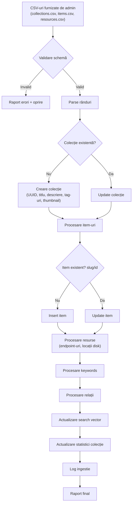
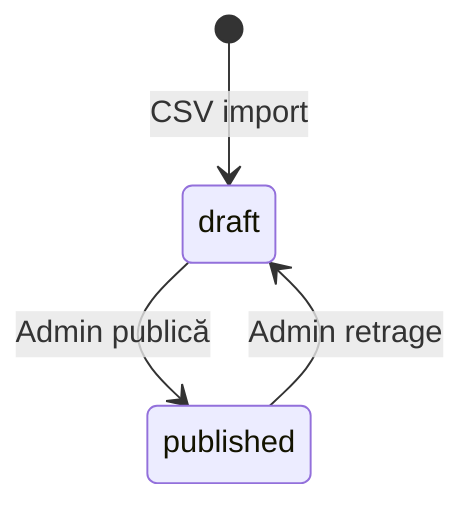
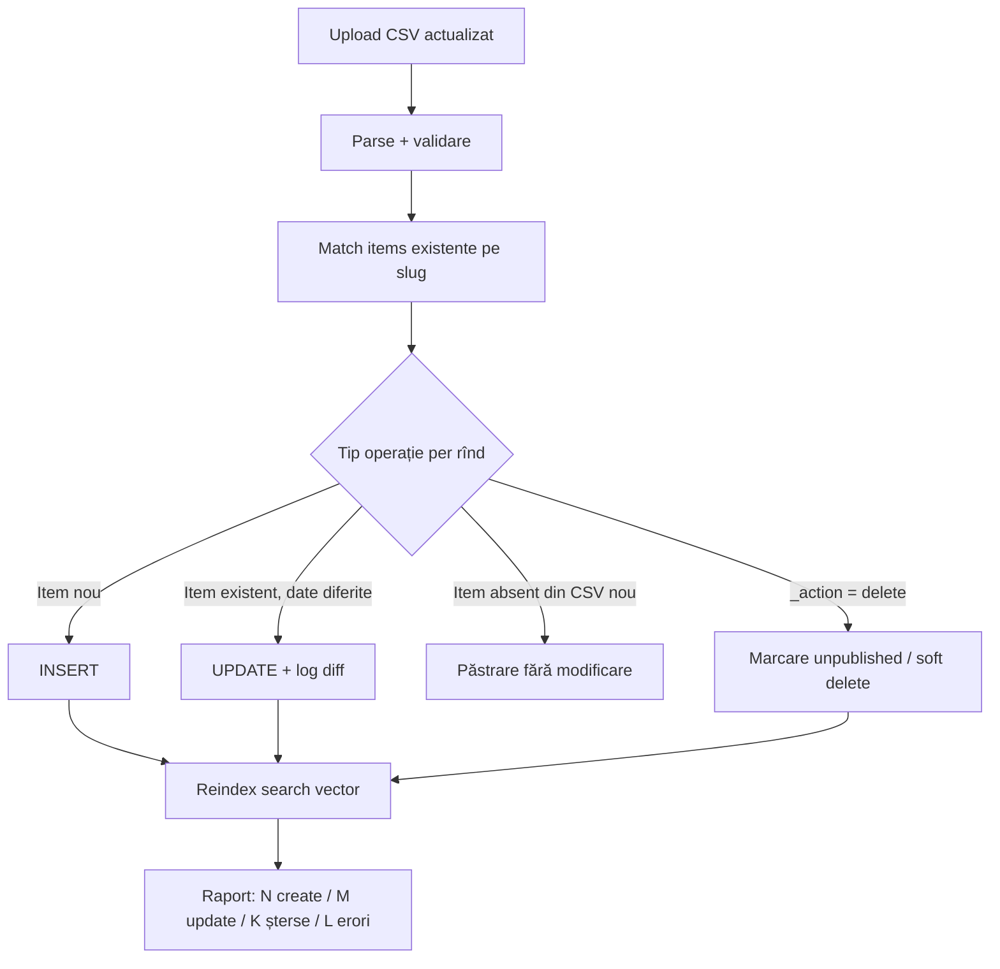
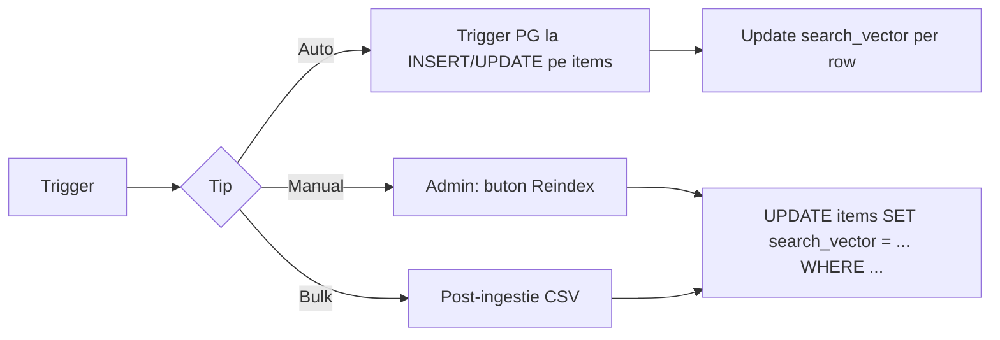

# C. Fluxuri de Lucru

> **Principiu:** Aplicația nu se ocupă de pregătirea datelor. Echipa de administrare furnizează prin CSV-uri endpoint-urile, locațiile pe disk și thumbnails-urile deja generate.

## C.1. Flux principal de ingestie CSV



## C.2. Thumbnails

> **Thumbnails-urile sînt furnizate de echipa de administrare.** Aplicația nu generează thumbnails.
> URL-ul sau calea pe disk a thumbnail-ului se specifică în `collections.csv` (coloana `thumbnail`) și în `resources.csv` (resurse cu `role=thumbnail`).

## C.3. Flux validare și publicare



**Reguli:**
- Doar items cu `validation_status = published` apar în frontend-ul public
- Items în `draft` — vizibile doar în admin
- Colecțiile devin vizibile cînd au cel puțin un item `published`

## C.4. Flux actualizare incrementală



**Reguli actualizare incrementală:**
- **Nu se șterge niciodată automat** un item absent din CSV-ul nou
- Ștergerea explicită: cîmpul `_action = delete` sau din admin UI
- La update se păstrează UUID-ul existent — slug-ul poate fi actualizat cu redirect 301
- Se loghează fiecare modificare (cîmpul vechi vs. nou) pentru audit

## C.5. Flux permalink-uri

1. La creare, fiecare item primește un `slug` stabil:
   - Derivat din: `{collection_slug}/{item_slug}`
   - Slug generat din titlu (transliterare + slugify) dacă nu e furnizat explicit
2. UUID-ul servește ca identificator intern permanent
3. Permalink public: `/explorer/collections/{collection_slug}/{item_slug}`
4. Dacă slug-ul se schimbă → se creează redirect 301 din slug-ul vechi
5. Tabela `slug_redirects` (opțional) păstrează slug-uri vechi:

```sql
CREATE TABLE slug_redirects (
    old_slug TEXT PRIMARY KEY,
    new_slug TEXT NOT NULL,
    created_at TIMESTAMPTZ DEFAULT now()
);
```

## C.6. Flux reindexare search



- **Reindexarea automată** se face via trigger-ul PostgreSQL (deja definit în schema)
- **Reindexarea manuală** — utilă după modificări de masă sau schimbări în logica de weighting:

```sql
UPDATE items SET updated_at = now();
-- trigger-ul recalculează automat search_vector
```

## C.7. Flux complet ingestie — Exemplu concret

```
1. Admin furnizează `collections.csv` + `items.csv` + `resources.csv`
2. Sistem: validare schemă → OK
3. Sistem: procesează collections.csv → crează/update colecții (UUID, titlu, descriere, tag-uri, thumbnail)
4. Sistem: procesează items.csv (500 rînduri):
   - 480 items noi → INSERT
   - 15 items existente → UPDATE
   - 5 rînduri cu erori → SKIP + log
5. Sistem: procesează resources.csv:
   - scan_url/disk_path → resource(type=scan, role=download)
   - georef_url/disk_path → resource(type=georeferenced_raster, role=download)
   - cog_url/disk_path → resource(type=cog, role=view) — pentru TiTiler
   - wms_url → resource(type=wms, role=service/view) — inclusiv GeoServer EPSG:404000
   - thumbnail_url/disk_path → resource(type=thumbnail, role=thumbnail)
6. Sistem: recalculează statistici per colecție
7. Sistem: loghează rezultat: 480 create, 15 update, 5 erori
8. Admin: verifică raportul, corectează cele 5 erori, re-importă
```
