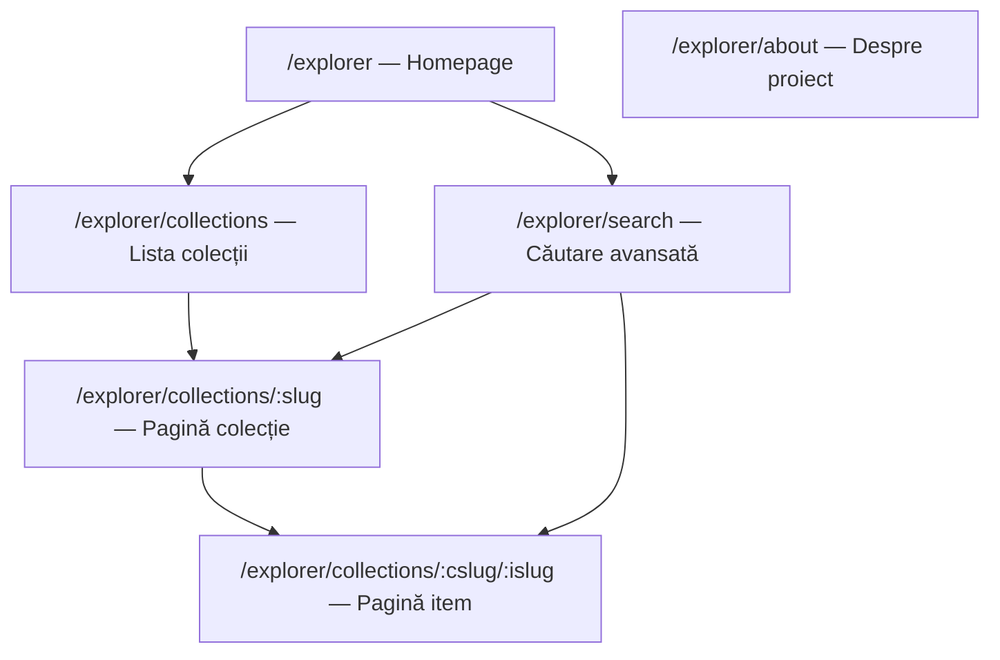
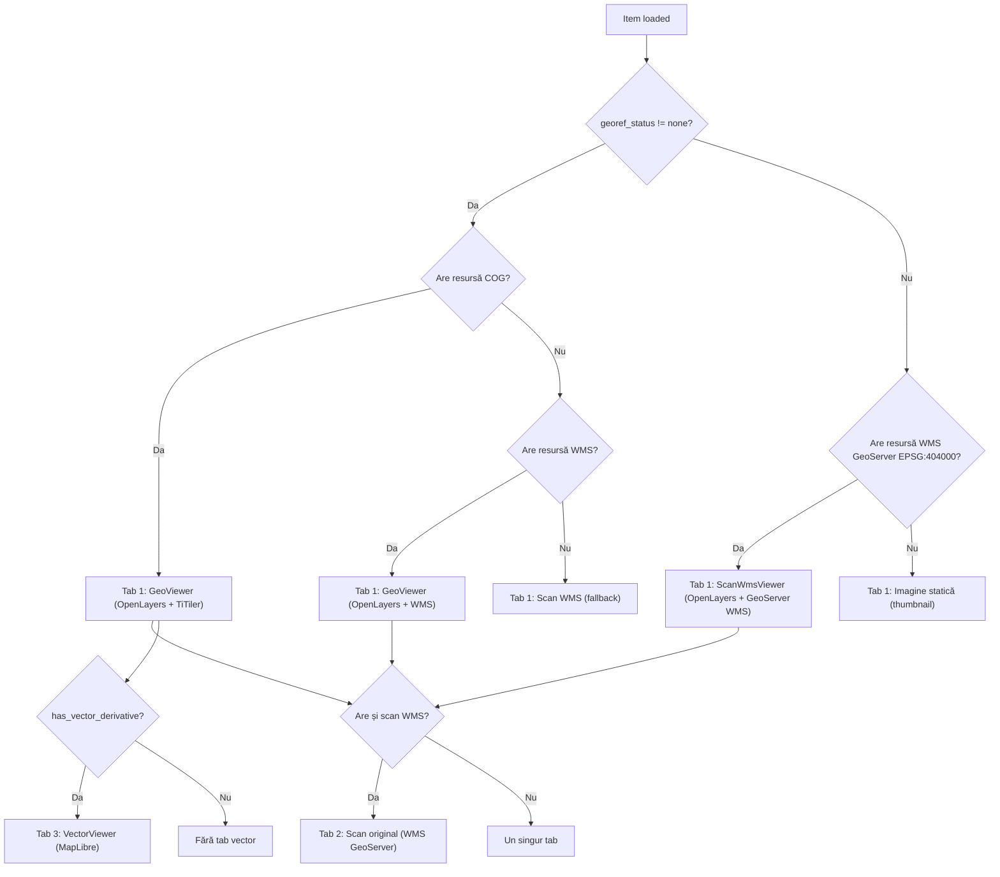

# D. UX / UI

> **Scop:** Interfața de explorare a colecțiilor geo-spatial.org (eHarta + colecții mai recente).
> Toate rutele sub `/explorer`.

## D.1. Structura paginilor



## D.2. Homepage

| Secțiune | Conținut |
|---|---|
| **Hero** | Titlu proiect, descriere scurtă, search bar prominent centrat |
| **Colecții recente** | Grid 4-8 colecții: imagine + titlu + nr. items + perioadă |
| **Statistici** | Total colecții, total items, items georeferențiate, acoperire temporală |
| **Navigare rapidă** | Butoane: „Explorează colecțiile", „Căutare avansată" |
| **Mini-hartă** | Hartă cu footprint-urile tuturor colecțiilor (click → colecție) |
| **Footer** | Despre, contact, licență, link API, credits |

**Layout:** Single column, hero full-width, grid responsive (1/2/3/4 coloane).

## D.3. Pagină Listă Colecții (`/collections`)

### Layout
- **Toolbar sus:** search bar inline, sort dropdown, view toggle (grid/list)
- **Sidebar stînga (desktop):** filtre colapsabile
- **Content area:** grid sau listă de carduri colecție
- **Mobile:** filtre într-un drawer/bottom sheet

### Card colecție
```
┌─────────────────────────┐
│  [Imagine reprezentativă] │
│                           │
│  Atlas Militar 1916       │
│  1914-1918 · 48 items    │
│  ▪ 32 georef  ▪ 5 vector │
│  Instituția X             │
│  [Badge: Atlas] [Badge:RO]│
└─────────────────────────┘
```

### Filtre sidebar

| Filtru | Tip control | Valori |
|---|---|---|
| Perioadă temporală | Range slider dublu | year_min – year_max |
| Instituție | Multi-select + search | Din DB, distinct |
| Limbă | Multi-select | Din DB, distinct |
| Clasificare / tip | Multi-select | atlas, serie, fond etc. |
| Arie geografică | Mini-hartă cu draw bbox | Coordonate |
| Cuvinte cheie | Autocomplete multi-tag | Din DB |

### Sortare
- Titlu (A-Z / Z-A)
- Perioadă (cronologic / invers)
- Nr. items (desc / asc)
- Recent adăugate

## D.4. Pagină Colecție (`/collections/:slug`)

```
┌────────────────────────────────────────────────────────┐
│ Breadcrumbs: Home > Colecții > Atlas Militar 1916      │
├────────────────────────────────────────────────────────┤
│                                                        │
│  # Atlas Militar 1916                                  │
│  Descriere: Lorem ipsum dolor sit amet...              │
│                                                        │
│  Perioadă: 1914-1918  │  Autor: Marele Stat Major     │
│  Instituție: ANR      │  Limbă: RO, DE                │
│  Licență: CC-BY 4.0   │  Tip: Atlas tematic           │
│                                                        │
│  ┌─────────────────────────────────────────────┐       │
│  │  Mini-hartă: extensie colecție              │       │
│  │  + footprint-uri items (click → item)       │       │
│  └─────────────────────────────────────────────┘       │
│                                                        │
│  Statistici: 48 items │ 32 georef │ 5 vector │ 11 text│
│                                                        │
├────────────────────────────────────────────────────────┤
│  Filtre items: [Tip ▾] [Perioadă ▾] [Georef ▾] [Kw]  │
│  Sortare: [Titlu ▾]  View: [Grid] [List] [Map]        │
├────────────────────────────────────────────────────────┤
│                                                        │
│  ┌──────┐  ┌──────┐  ┌──────┐  ┌──────┐              │
│  │thumb │  │thumb │  │thumb │  │thumb │              │
│  │Pl.I  │  │Pl.II │  │Pl.III│  │Pl.IV │              │
│  │1916  │  │1916  │  │1917  │  │1917  │              │
│  │[map] │  │[map] │  │[text]│  │[map] │              │
│  │●georef│  │●georef│  │      │  │●georef│              │
│  └──────┘  └──────┘  └──────┘  └──────┘              │
│                                                        │
│  Paginare: « 1 2 3 ... 12 »                           │
│                                                        │
├────────────────────────────────────────────────────────┤
│  Linkuri externe: [Catalog original] [Sursa digitală]  │
└────────────────────────────────────────────────────────┘
```

## D.5. Pagină Item (`/explorer/collections/:cslug/:islug`)

### Layout desktop: două coloane (60% / 40%)

```
┌──────────────────────────────────────────────────────────────┐
│ Breadcrumbs: Home > Colecții > Atlas Militar > Planșa XII    │
├──────────────────────────────────────┬───────────────────────┤
│                                      │                       │
│  ┌──────────────────────────────┐    │  # Planșa XII         │
│  │                              │    │  ## Brăila și Galați  │
│  │                              │    │                       │
│  │      VIEWER AREA             │    │  Colecție: Atlas Mil. │
│  │                              │    │  Tip: Hartă           │
│  │  (OpenLayers / OpenSeadragon │    │  An: 1916             │
│  │   / MapLibre — autodetect)   │    │  Autor: SMR           │
│  │                              │    │  Scară: 1:200000      │
│  │                              │    │  CRS: Bonne           │
│  └──────────────────────────────┘    │  Limbă: RO            │
│                                      │  Georef: ● Precis     │
│  Toolbar:                            │                       │
│  [🔍+][🔍-][↺Reset][◐Opacity]      │  ── Descriere ──      │
│  [⛶ Fullscreen][🗺️ Basemap ▾]      │  Planșă topografică...│
│                                      │                       │
│  Tabs (dacă multiple vizualizări):   │  ── Cuvinte cheie ──  │
│  [Hartă georef.] [Scan original]     │  [militar] [topografie]│
│  [Date vectoriale]                   │  [Brăila] [Dunăre]    │
│                                      │                       │
│                                      │  ── Download ──       │
│                                      │  📥 Scan TIFF (45 MB) │
│                                      │  📥 GeoTIFF (52 MB)   │
│                                      │  📥 GeoPackage (3 MB)  │
│                                      │                       │
│                                      │  ── Servicii ──       │
│                                      │  🌐 WMS endpoint      │
│                                      │  🌐 COG tiles         │
│                                      │  🌐 OGC API Features  │
│                                      │                       │
│                                      │  ── Relații ──        │
│                                      │  → Planșa XI (prev)   │
│                                      │  → Planșa XIII (next)  │
│                                      │  → Vector derivat     │
│                                      │                       │
│                                      │  ── Proveniență ──    │
│                                      │  Scanat din exemplarul│
│                                      │  ANR, cota 234/1916   │
│                                      │                       │
├──────────────────────────────────────┴───────────────────────┤
│  Permalink: https://services.geo-spatial.org/explorer/       │
│  collections/atlas-militar-1916/plansa-xii-braila            │
└──────────────────────────────────────────────────────────────┘
```

### Layout mobile: stacked
- Viewer sus (full-width, aspect ratio 4:3)
- Tabs viewer sub viewer
- Metadata panel colapsabil sub
- Download/Services panel colapsabil

### Logica de selecție viewer



## D.6. Căutare (`/explorer/search`)

### Layout

```
┌──────────────────────────────────────────────────────────────┐
│  🔍 [_____________search query______________] [Caută]        │
│     Autocomplete suggestions appear here                     │
├──────────────┬───────────────────────────────────────────────┤
│              │                                               │
│  FILTRE      │  View: [Grid] [List] [Map]                   │
│              │  Sortare: [Relevanță ▾]                      │
│  Colecție    │  234 rezultate                                │
│  [▾ multi]   │                                               │
│              │  ┌──────┐  ┌──────┐  ┌──────┐  ┌──────┐    │
│  Tip item    │  │ card │  │ card │  │ card │  │ card │    │
│  [▾ multi]   │  └──────┘  └──────┘  └──────┘  └──────┘    │
│              │  ┌──────┐  ┌──────┐  ┌──────┐  ┌──────┐    │
│  Perioadă    │  │ card │  │ card │  │ card │  │ card │    │
│  [===●===]   │  └──────┘  └──────┘  └──────┘  └──────┘    │
│              │                                               │
│  Georef      │  Paginare: « 1 2 3 ... 12 »                 │
│  [▾ status]  │                                               │
│              │  ─── SAU în Map view: ───                    │
│  Are vector  │                                               │
│  [toggle]    │  ┌───────────────────────────────────────┐   │
│              │  │                                       │   │
│  Limbă       │  │  Hartă cu footprint-uri rezultate     │   │
│  [▾ select]  │  │  Click pe footprint → popup           │   │
│              │  │  → thumbnail + titlu + link            │   │
│  Bbox        │  │                                       │   │
│  [mini-hartă]│  └───────────────────────────────────────┘   │
│              │                                               │
│  Keywords    │                                               │
│  [tag input] │                                               │
│              │                                               │
│  [Resetează] │                                               │
│              │                                               │
└──────────────┴───────────────────────────────────────────────┘
```

**URL reflectă starea:**
```
/explorer/search?q=braila&collection=atlas-militar-1916&type=map&georef=accurate
       &year_min=1800&year_max=1920&bbox=25.5,44.2,28.1,45.8&sort=relevance&page=2
```

## D.7. Viewer raster georeferențiat (GeoViewer)

**Tehnologie:** OpenLayers 9+ cu tile-uri de la TiTiler (COG)

**Funcționalități:**

| Feature | Implementare |
|---|---|
| Basemap | Tile layer OSM (default) + opțional satelit, CartoDB |
| Overlay raster | XYZ tiles via TiTiler din COG |
| Opacitate | Slider 0-100%, aplică pe overlay layer |
| Zoom-to-extent | Buton „Fit” → zoom la bounding_box-ul itemului |
| Footprint | Vector layer cu bounding_box/footprint ca poligon semi-transparent |
| Fullscreen | OpenLayers FullScreen control |
| Scale bar | OpenLayers ScaleLine |
| Coordinate display | Mouse position în WGS84 |
| Swipe/Split (Faza 2) | ol-ext swipe control sau custom split view |

**Basemaps disponibile:**
- OpenStreetMap (default)
- CartoDB Positron (light, bun contrast cu hărți istorice)
- CartoDB Dark Matter (dark)
- Esri World Imagery (satelit) — dacă licența permite
- Fără basemap (doar overlay)

## D.8. Viewer scanări non-georeferențiate (ScanWmsViewer)

**Tehnologie:** OpenLayers 9+ cu WMS de la GeoServer

**Endpoint:** `https://services.geo-spatial.org/geoserver` cu EPSG:404000

**Funcționalități:**
- Vizualizare scanări prin WMS layer (EPSG:404000 — image coordinates)
- Pan cu drag
- Zoom cu scroll/pinch/butoane
- Reset view
- Fullscreen
- Opacitate (dacă se suprapune pe basemap)

**Implementare OpenLayers:**
```javascript
const wmsLayer = new TileLayer({
  source: new TileWMS({
    url: `${GEOSERVER_URL}/wms`,
    params: {
      LAYERS: layerName, // din resources.layer_name
      FORMAT: 'image/png',
      SRS: 'EPSG:404000',
    },
  }),
});
```

## D.9. Viewer vectorial (VectorViewer)

**Tehnologie:** MapLibre GL JS

**Funcționalități:**

| Feature | Implementare |
|---|---|
| Încărcare vector | GeoJSON (mic) / FlatGeobuf stream (mare) / MVT (Faza 2) |
| Basemap | MapLibre style (OSM Liberty / Positron) |
| Popup inspect | Click pe feature → popup cu atribute |
| Legendă | Panel cu simboluri per strat |
| Stilizare | Culori per categorie din `style` JSON (din vector_datasets) |
| Filtrare | Dropdown simplu pe un atribut categorial |
| Tabel atribute | Panel expandabil cu DataTable (sortabil, filtrabil) |
| Zoom to extent | Fit bounds pe datele vectoriale |

## D.10. Componente UI — Inventar complet

| Componentă | Bibliotecă bază | Descriere |
|---|---|---|
| `<CollectionCard>` | shadcn Card | Card colecție: imagine, titlu, stats, badges |
| `<ItemCard>` | shadcn Card | Card item: thumbnail, titlu, an, tip, georef badge |
| `<GeoViewer>` | OpenLayers | Map viewer georeferențiat (TiTiler COG) |
| `<ScanWmsViewer>` | OpenLayers | Viewer scanări non-georef (WMS GeoServer EPSG:404000) |
| `<VectorViewer>` | MapLibre GL | Vector data viewer |
| `<ViewerSwitcher>` | shadcn Tabs | Comutare între viewere pe baza datelor |
| `<ViewerToolbar>` | Custom | Zoom, reset, opacity, basemap, fullscreen |
| `<OpacitySlider>` | shadcn Slider | Control opacitate overlay |
| `<BasemapSwitcher>` | shadcn Select | Dropdown basemap |
| `<MetadataPanel>` | shadcn components | Afișare structurată metadate item |
| `<ResourceList>` | Custom | Lista resurse grupate pe download/view/service |
| `<ResourceBadge>` | shadcn Badge | Badge format: COG, WMS, GeoJSON etc. |
| `<SearchBar>` | shadcn Command | Input + autocomplete cu debounce |
| `<FilterPanel>` | shadcn Accordion | Filtre colapsabile |
| `<FilterCheckboxGroup>` | shadcn Checkbox | Multi-select pentru tipuri/statusuri |
| `<TimeRangeSlider>` | rc-slider / custom | Slider dublu pentru intervale an |
| `<BBoxSelector>` | OpenLayers mini-map | Draw rectangle pe hartă |
| `<KeywordTags>` | Custom | Input tag cu autocomplete |
| `<Breadcrumbs>` | shadcn Breadcrumb | Navigare ierarhică |
| `<BadgeGeoref>` | shadcn Badge | Badge color-coded: none/approx/accurate/precise |
| `<BadgeItemType>` | shadcn Badge | Badge tip item |
| `<Pagination>` | shadcn Pagination | Paginare rezultate |
| `<StatsBar>` | Custom | Statistici sumare (nr. items, tipuri etc.) |
| `<RelatedItems>` | Custom | Lista items înrudite cu link-uri |
| `<PermalinkDisplay>` | Custom | Afișare + copy permalink |
| `<CollectionMiniMap>` | OpenLayers | Hartă mică cu extensia colecției |
| `<SearchResultsMap>` | OpenLayers | Hartă rezultate cu footprint-uri |
| `<DataTable>` | TanStack Table | Tabel atribute vectoriale, sortabil |
| `<FeaturePopup>` | MapLibre Popup | Popup inspect atribute |
| `<VectorLegend>` | Custom | Legendă pentru straturi vectoriale |
