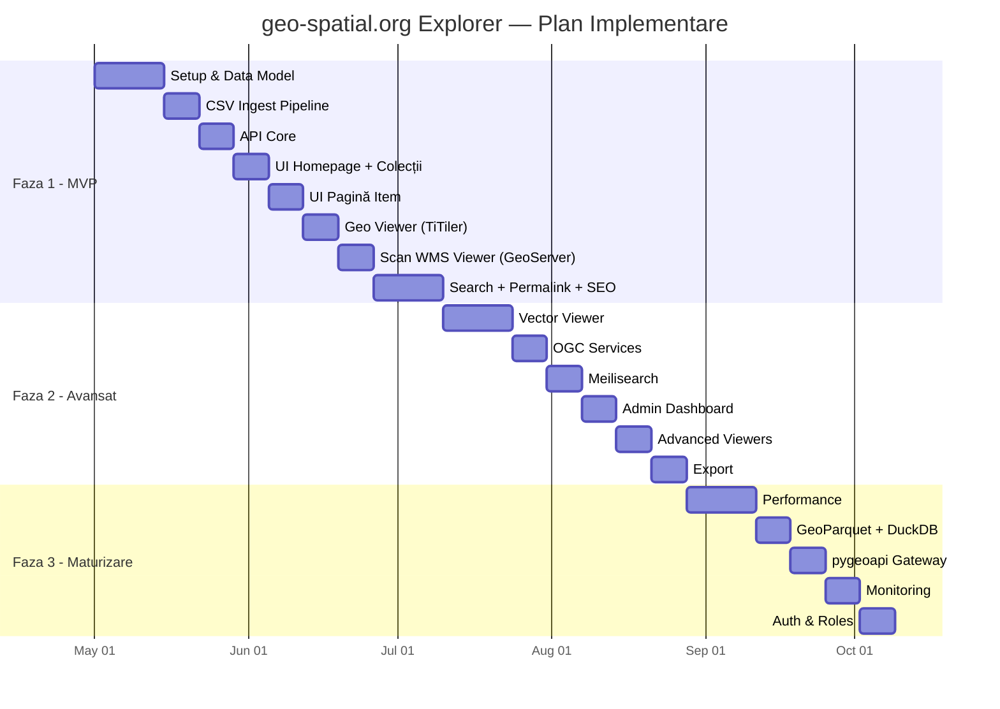

# G. Plan de Implementare Etapizat

> **Scop:** Explorarea colecțiilor de date geo-spatial.org (eHarta + colecții mai recente).
> **Principiu:** Aplicația nu pregătește date. Datele, thumbnails-urile și COG-urile sînt furnizate de echipa admin prin CSV-uri.

## Faza 1 — MVP (7-9 săptămîni)

**Obiectiv:** Aplicație funcțională la `/explorer` cu import CSV, navigare, vizualizare georef (TiTiler) + scan non-georef (WMS GeoServer), download.

### Desfășurare pe săptămîni

| Săpt. | Livrabil | Detalii |
|---|---|---|
| 1-2 | **Setup & Data Model** | Docker Compose (PG+PostGIS, TiTiler), schema DB completă, migrări Drizzle, `.env` configurabil, seed data cu 2-3 colecții de test |
| 2-3 | **CSV Ingest Pipeline** | Parser CSV (collections.csv + items.csv + resources.csv), validare Zod, import colecții (UUID, titlu, descriere, tag-uri, thumbnail) + items + resurse cu endpoint-uri/locații disk, logging, raport erori |
| 3-4 | **API Core** | Next.js API routes sub `/explorer/api`: GET colecții, items, resurse; paginare cursor-based; filtre; FTS cu pg_trgm |
| 4-5 | **UI: Homepage + Colecții** | Homepage `/explorer` cu hero + grid colecții, pagina lista colecții cu filtre + sortări, card components cu thumbnails din CSV |
| 5-6 | **UI: Pagină Item** | Layout dual-column, metadata panel, resource list, breadcrumbs, permalink display |
| 6-7 | **Geo Viewer (georef)** | OpenLayers: basemap OSM, overlay COG via TiTiler (de pe disk), slider opacitate, zoom-to-extent, fullscreen |
| 7-8 | **Scan WMS Viewer (non-georef)** | OpenLayers: WMS de la GeoServer `services.geo-spatial.org` cu EPSG:404000, zoom/pan, fullscreen |
| 8-9 | **Search + Permalink + SEO** | Pagina search cu filtre + rezultate grid/list, URL state sync, JSON-LD, sitemap, OG tags |

### Livrabile Faza 1

- Aplicație deployată (Docker Compose, un singur server) la `/explorer`
- Import funcțional din CSV-uri (collections.csv + items.csv + resources.csv)
- Navigare colecții → items cu filtre și sortări
- Viewer georeferențiat (OpenLayers + TiTiler/COG de pe disk)
- Viewer scanări non-georef (OpenLayers + WMS GeoServer EPSG:404000)
- Viewer switcher automat pe baza tipului item
- Search full-text cu pg_trgm + filtre
- Download resurse (link direct / disk)
- Listare servicii WMS/WMTS externe
- Permalink-uri stabile sub `/explorer/collections/...`
- Thumbnails furnizate prin CSV (nu generate de aplicație)
- SEO de bază (JSON-LD, sitemap)
- Configurare completă prin `.env`

### Dependențe Faza 1

- CSV-uri de test (collections.csv + items.csv + resources.csv, minim 2-3 colecții, 50-100 items)
- Cîteva COG-uri de test pe disk (pregătite extern)
- Layer-uri WMS configurate pe GeoServer pentru scanările non-georef
- Design decisions finalizate (vezi secțiunea H)
- Domeniu / hosting decision

### Riscuri Faza 1

| Risc | Impact | Mitigare |
|---|---|---|
| Calitatea datelor CSV inconsistentă | Mediu | Validare robustă, rapoarte detaliate, template CSV |
| Performanța TiTiler pe COG-uri mari (>1GB) | Mediu | Teste timpurii, overview-uri corect generate (extern) |
| GeoServer WMS EPSG:404000 — lipsă layere | Mediu | Verificare timpurie că layerele necesare sînt publicate |
| Slug collisions | Scăzut | Uniqueness check + suffix numeric automat |

---

## Faza 2 — Funcționalități Avansate (6-8 săptămîni)

**Obiectiv:** Vector viewer, OGC services, admin dashboard, căutare avansată.

### Desfășurare pe săptămîni

| Săpt. | Livrabil |
|---|---|
| 1-2 | **Vector Viewer** — MapLibre GL: încărcare GeoJSON/FlatGeobuf, popup atribute, legendă, stilizare pe categorii, tabel atribute cu TanStack Table |
| 2-3 | **OGC Services** — pg_featureserv container, OGC API Features pentru date vectoriale; Martin container, MVT tiles din PostGIS |
| 3-4 | **Meilisearch** — Container setup, sync pipeline PG → Meilisearch, faceted search UI, typo tolerance |
| 4-5 | **Admin Dashboard** — Pagină protejată sub `/explorer/admin`: upload CSV cu preview, progress ingestie, raport erori, publish/unpublish items/colecții |
| 5-6 | **Advanced Viewers** — Swipe/split view (georef vs. basemap), opacity comparison, multiple basemaps, coordinate display |
| 6-7 | **Export** — KML export on-demand din PostGIS, download panel îmbogățit |

### Livrabile Faza 2

- Vector viewer complet (MapLibre + popup + legendă + tabel atribute)
- OGC API Features (pg_featureserv) + MVT (Martin)
- Căutare cu facete (Meilisearch)
- Admin UI (ingestie CSV, validare, publicare)
- Swipe/compare view
- KML export
- Map view în search results (footprint-uri pe hartă)

### Dependențe Faza 2

- Faza 1 completă
- Date vectoriale de test (GeoPackage / GeoJSON, furnizate prin CSV)
- Decizii despre roluri admin/editor

### Riscuri Faza 2

| Risc | Impact | Mitigare |
|---|---|---|
| Complexitate integrare servicii Docker | Mediu | Docker Compose profiles, health checks, startup order |
| Sync PG → Meilisearch lag | Scăzut | Trigger-based sync, fallback la PG FTS |
| FlatGeobuf streaming pe date >100MB | Scăzut | Spatial index obligatoriu, paginare |

---

## Faza 3 — Maturizare (4-6 săptămîni)

**Obiectiv:** Optimizare, interoperabilitate extinsă, monitorizare, scalabilitate.

### Desfășurare pe săptămîni

| Săpt. | Livrabil |
|---|---|
| 1-2 | **Performance** — Redis cache API responses, CDN pentru tiles + thumbnails, ISR tuning, lazy loading viewere, image optimization (WebP/AVIF) |
| 2-3 | **GeoParquet + DuckDB-WASM** — Vizualizare/interogare GeoParquet direct în browser (experimental), download GeoParquet |
| 3-4 | **pygeoapi Gateway** — OGC API Records (catalog), OGC API Tiles, WMS/WMTS proxy, CSW legacy endpoint |
| 4-5 | **Monitoring & Observability** — Prometheus metrics, Grafana dashboards, health checks per serviciu, link checker periodic, alerting |
| 5-6 | **Auth & Roles** — NextAuth.js (OAuth / credentials), roluri admin/editor/viewer, audit log, rate limiting API |

### Livrabile Faza 3

- Performanță optimizată (cache, CDN, lazy loading)
- GeoParquet support (download + experimental browser query)
- OGC gateway complet (pygeoapi)
- Monitoring stack (Prometheus + Grafana)
- Link checker automat
- Autentificare + roluri
- Audit log

### Dependențe Faza 3

- Faza 2 completă
- Decizie hosting producție (cloud vs. on-premise)
- Budget CDN
- Identity provider decision (OAuth provider)

### Riscuri Faza 3

| Risc | Impact | Mitigare |
|---|---|---|
| DuckDB-WASM maturity | Scăzut | Feature experimental, fallback la download only |
| pygeoapi configuration complexity | Mediu | Configurare YAML generată automat din DB |
| Redis + CDN cache invalidation | Mediu | TTL-based, revalidatePath la update |

---

## Timeline vizuală

