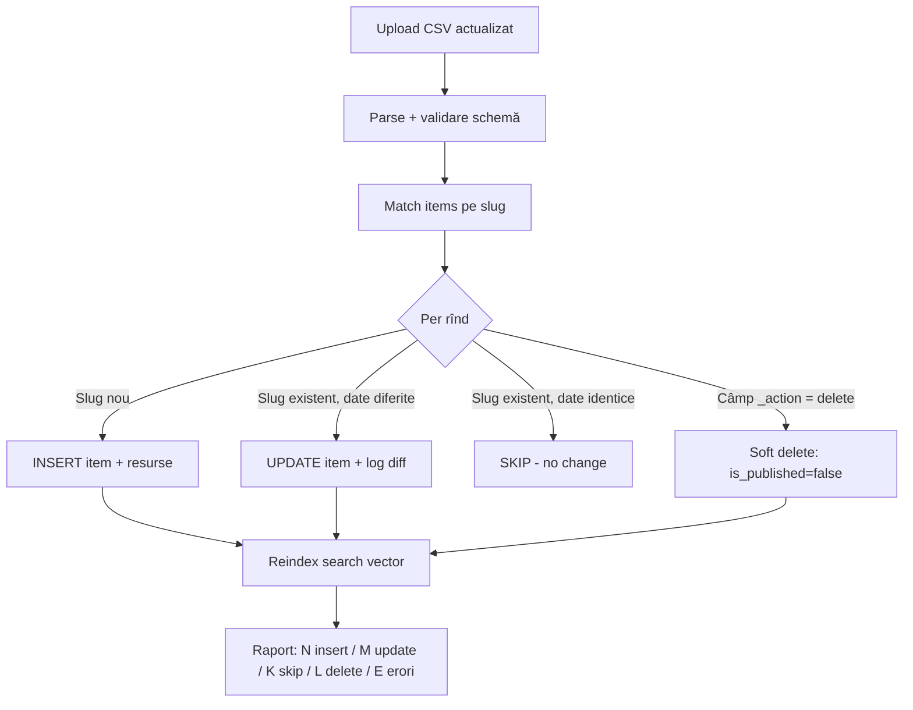
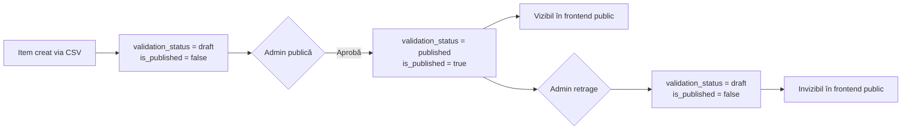

# J. Administrare și Mentenanță

> **Principiu:** Administrarea se face prin CSV-uri. Aplicația nu pregătește date (fără conversie COG, fără generare thumbnails).
> Echipa admin furnizează colecții, items și resurse cu endpoint-uri și locații pe disk.

## J.1. Dashboard Admin (Faza 2)

| Funcționalitate | Descriere | Prioritate |
|---|---|---|
| **Ingest CSV** | Upload CSV-uri (collections.csv, items.csv, resources.csv), preview primele 10 rînduri, validare schemă, preview erori, buton import cu progress bar | Obligatoriu |
| **Raport ingestie** | Per ingestie: rînduri importate / skip / erori, detalii per rînd cu eroare, download raport CSV | Obligatoriu |
| **Manage colecții** | Lista colecții cu search, edit metadate inline, publish/unpublish | Obligatoriu |
| **Manage items** | Tabel paginat cu toate items, filtre (colecție, tip, status), edit metadate, publish/unpublish, bulk actions | Obligatoriu |
| **Link checker** | Verificare periodică URL-uri resurse și endpoint-uri WMS (cron zilnic), raport linkuri invalide cu status HTTP, timestamp ultima verificare | Important |
| **Statistici** | Dashboard: total colecții, items per status, items per tip, items per georef status, top colecții | Important |
| **Audit log** | Tabel: cine a modificat ce, cînd, valori vechi vs. noi (pentru metadate), retenție 90 zile | Faza 3 |
| **Reindexare** | Buton trigger manual reindexare search (PG FTS sau Meilisearch sync), status reindexare | Important |
| **User management** | Lista utilizatori, roluri (admin/editor/viewer), invite, dezactivare | Faza 3 |

## J.2. Validare la ingestie

### Reguli de validare per câmp

| Câmp | Nivel | Regulă | Acțiune la violare |
|---|---|---|---|
| `title` | **Error** | Obligatoriu, non-empty | Rînd respins |
| `collection_slug` | **Error** | Obligatoriu, non-empty | Rînd respins |
| `item_type` | **Error** | Valoare din enum `item_types` | Rînd respins |
| `year_start` | **Error** | Integer, 0 < year ≤ current_year (dacă prezent) | Rînd respins |
| `year_end` | **Error** | Integer, `year_end ≥ year_start` (dacă ambele prezente) | Rînd respins |
| `georef_status` | **Warning** | Valoare din enum sau gol | Default `none` |
| `bbox_west`, `bbox_south`, `bbox_east`, `bbox_north` | **Warning** | Numere valide, west < east, south < north, în range WGS84 | Se ignoră bbox |
| `scan_url`, `georef_url`, `cog_url`, `wms_url` | **Warning** | URL valid (regex) dacă non-empty | Resursă ignorată |
| `slug` | **Warning** | Caractere permise: `[a-z0-9-]` | Generat automat din title |
| Slug duplicat | **Warning** | Slug deja există în DB | UPDATE în loc de INSERT |
| Toate cîmpurile opționale | **Info** | Goale → NULL | Stocat ca NULL |

### Format raport ingestie

```json
{
  "ingest_id": "uuid",
  "filename": "items_lot3.csv",
  "started_at": "2026-04-04T14:00:00Z",
  "finished_at": "2026-04-04T14:02:30Z",
  "status": "partial",
  "summary": {
    "total_rows": 500,
    "imported": 480,
    "updated": 15,
    "skipped": 5,
    "errors": 5,
    "resources_created": 960
  },
  "errors": [
    {
      "row": 34,
      "field": "item_type",
      "value": "harta",
      "message": "Invalid item_type. Expected one of: map, plate, atlas_page, chart, text_page, table, legend, technical, composite, other",
      "level": "error"
    },
    {
      "row": 127,
      "field": "year_end",
      "value": "1800",
      "message": "year_end (1800) < year_start (1850)",
      "level": "error"
    }
  ],
  "warnings": [
    {
      "row": 45,
      "field": "georef_status",
      "value": "",
      "message": "Empty georef_status, defaulting to 'none'",
      "level": "warning"
    }
  ]
}
```

## J.3. Actualizări incrementale

### Strategia de update



### Reguli importante

1. **Nu se șterge automat** un item absent din CSV-ul nou (protecție contra ștergeri accidentale)
2. **Ștergere explicită:** doar cu `_action = delete` în CSV sau din admin UI
3. **UUID-ul rămîne stabil** la update — doar metadatele se modifică
4. **Slug update:** dacă title-ul se schimbă și slug-ul era auto-generat → slug NOU + redirect 301 de la vechiul slug
5. **Diff logging:** se stochează cîmpurile vechi vs. noi pentru fiecare update (audit trail)

## J.4. Monitorizare linkuri și servicii

### Link checker (Faza 2-3)

**Implementare:** Cron job (sau BullMQ scheduled job) care verifică periodic toate URL-urile din `resources`:

```
Frecvență: zilnic (noaptea)
Metoda: HEAD request cu timeout 10s
Retry: 2 încercări cu backoff
```

| Status | Acțiune |
|---|---|
| 200-299 | OK — marcat healthy |
| 301/302 | Warning — redirect (posibil URL schimbat) |
| 403/404 | Error — link invalid |
| 5xx | Warning — server down temporar |
| Timeout | Warning — server lent |

**Raport:** Tabel admin cu: item slug, resource URL, last check, status, last OK date.

### Health checks servicii

| Serviciu | Endpoint health | Frecvență |
|---|---|---|
| PostgreSQL | `SELECT 1` | 30s |
| TiTiler | `GET /healthz` | 30s |
| GeoServer (extern) | `GET /geoserver/web/` | 300s |
| Meilisearch (Faza 2) | `GET /health` | 30s |
| Martin (Faza 2) | `GET /catalog` | 30s |
| pg_featureserv (Faza 2) | `GET /api` | 30s |

## J.5. Backup și disaster recovery

### Backup schedule (Faza 3)

| Component | Metodă | Frecvență | Retenție |
|---|---|---|---|
| PostgreSQL | `pg_dump` comprimat | Zilnic | 30 zile |
| Fișiere pe disk | Backup filesystem (rsync / snapshot) | Zilnic | 90 zile |
| CSV-uri administrare | Git repository | La fiecare modificare | Permanent |
| Configurări Docker + .env | Git repository | La fiecare modificare | Permanent |
| Ingest logs | Export JSON | Zilnic | 180 zile |

### Restore procedure

1. Restore PostgreSQL din dump: `pg_restore -d geospatial_explorer backup.dump`
2. Fișierele pe disk: restore din backup filesystem
3. Docker services: `docker compose up -d`
4. Reindex search: `POST /explorer/api/admin/reindex`
5. Verificare link checker: `POST /explorer/api/admin/check-links`

## J.6. Publicare / Unpublish workflow



**Reguli:**
- Frontend-ul public afișează DOAR items cu `is_published = true`
- API-ul public filtrează automat: `WHERE is_published = true`
- API-ul admin afișează toate items, indiferent de status
- Colecțiile devin vizibile cînd au cel puțin un item publicat
- Unpublish colecție → toate items-urile rămîn `is_published = true` dar colecția nu apare în lista publică
- `validation_status` simplu: doar `draft` / `published` (fără workflow complex)
